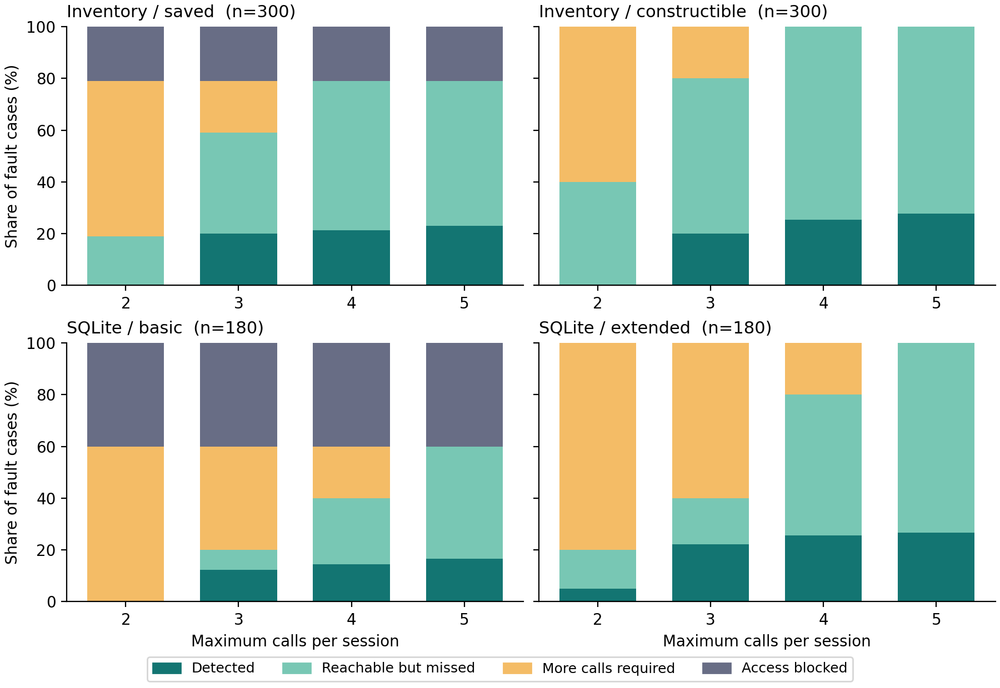

# 为什么黑盒工具验证会遗漏可检测的故障

**Why Black-Box Tool Verification Misses Detectable Failures: An Empirical Study of Budget, Access, and Test Selection**

2026 年 11 月 24 日 · 实证论文整合稿与补充实验报告

### 摘要

给定对工具行为的解释，同一处错误可能因为请求权限、调用预算或测试选择而逃过检查。我们以输出序列首次偏离正确参考的最短合法请求序列作为可达见证，配对比较日历、库存和 SQLite 事务会话。在库存已有菜单的 300 个故障场景中，三问内 177 个可达、60 个需要第四问、63 个缺少必要输入。在新增 SQLite 扩展菜单中，可达场景随二至五问依次从 36 增到 72、144、180。预算达到五问时，固定重访模板仍只发现 48 个，遗漏的 132 个均有可执行反例。历史关系权重在新工具上发现了错误，却再次落后于事先指定的固定模板。库存故障占比及故障族构成的重加权进一步表明，采用风险和策略排名均依赖目标分布。本文所支持的贡献是可复核的失败归因与跨工具实证。

### 研究设计与证据来源

完整的四个研究问题、贡献声明、文献对照和实验矩阵在补充运行前写入[研究设计](EMPIRICAL_STUDY_DESIGN_20261124_ZH.md)。历史关系学习代码与开发时的 SHA-256 一致。重新对齐原日历静态与自适应两步的 576 个配对场景，所有请求与真实返回逐场景相同；库存既有 6,480 条轨迹逐条核对了实际与期望输出、方法与场景身份。库存原三问 ABA 在本轮重放中的故障判断全部复现。日历的 73/242 和 121/943 分别是在不同历史子集上继续至第三问的条件命中数，没有随机分派的因果解释。[旧证据校验](../runs_empirical_study_20261124/archive_audit.json)

新环境是内存 SQLite 3.45.1 数据库上的双记录事务适配器，独立 Python 参考规格保存值与最多两层快照。每个测试会话重新建库，实际执行参数化读写、保存点、回滚和释放。基本菜单允许读写 A、设置保存点和回滚；扩展菜单另允许读写 B 和释放保存点。适配器对无有效保存点的控制命令返回相同确认，状态变化须通过后续读取观察。五个受控故障注入在适配层。真实组件是 SQLite 引擎，服务与故障均由本研究构造；没有网络延迟或线上缺陷采样。[SQLite 保存点语义](https://www.sqlite.org/lang_savepoint.html) · [接口与故障注入](empirical_sqlite.py)

每个 SQLite 权限使用 36 个初始值布局、1 个正确实现和 5 个故障实现。布局共享五种机制，仅改变初始数值与选问顺序，不能把 180 个布局–故障组合解释为 180 种独立缺陷。对每个基础布局的许可序列按长度由短到长执行搜索，首次差异保存为最短见证；实际搜索使用每权限一个代表布局，再在其余初始值上逐条回放。最短性可转移，是因为公开操作只加一、读取或复制快照，注入也只改变某行的增量、读取时刻或恢复点。每一行初始值的整体平移不会改变同一行期望值与实测值是否相等。对两项直接缺失必要操作的情况记录权限阻断证书。[全部见证及 288 条跨布局回放](../runs_empirical_study_20261124/sqlite_witnesses.json)

### RQ1：预算与权限分别阻断了哪些反例？

设 d(f,P) 为在权限 P 下推翻解释的最短请求数。可达定义为 d≤B，策略发现错误必须有实际返回为证。在被验证的有限任务中，“预算不足”要求有更长的见证；“权限阻断”要求能说明菜单移除了必需操作。搜索到五问仍未见异常而没有其他依据，应记录为“截至五问未找到”。如果扩大权限和增加预算都可以补救，归因应报告两个反事实；下表固定权限、优先核查在该权限下是否存在见证。

| 环境与权限 | 故障场景 | 两问可达 | 三问可达 | 四问可达 | 五问可达 | 权限阻断 |
|---|---:|---:|---:|---:|---:|---:|
| 库存已有菜单 | 300 | 57 | 177 | 237 | 237 | 63 |
| 库存可构造菜单 | 300 | 120 | 240 | 300 | 300 | 0 |
| SQLite 基本菜单 | 180 | 0 | 36 | 72 | 108 | 72 |
| SQLite 扩展菜单 | 180 | 36 | 72 | 144 | 180 | 0 |

库存的 63 项阻断来自缺少同一商品的另一种编码或缺少同货架第二商品。SQLite 的 72 项阻断由两种必要操作解释：基本菜单不能发起对 B 的写入，也不能释放保存点。即使增加读取次数，也触发不了对应的适配层错误。SQLite 基本菜单在两问时可达数为零，命中率的分母为空，因此只报告计数。



### RQ2：可达故障为什么仍被漏检？

对初始 A=20 的 SQLite 布局 0，五个最短见证说明了检测成本的来源。命令的确认相同，查询返回才暴露状态差异。

| 故障 | 最短序列 | 期望 / 实测 |
|---|---|---|
| 写 B 却改了 A | 写 B → 读 A | 20 / 21 |
| 写后读取旧缓存 | 读 A → 写 A → 读 A | 21 / 20 |
| 回滚命令被忽略 | 设点 → 写 A → 回滚 → 读 A | 20 / 21 |
| 释放保存点意外撤销修改 | 设点 → 写 A → 释放 → 读 A | 21 / 20 |
| 内层回滚错误地回到外层 | 设外点 → 写 A → 设内点 → 回滚 → 读 A | 21 / 20 |

表中的“写”均为加一。预算二到四时，最后一个故障属于预算不足。到五问时，该故障在两个权限均可达，本轮固定模板、状态前缀与均匀随机都未命中。故障归因随预算发生了可核查的变化。

补充经典基线选取公开控制状态的最短访问前缀，再作均匀随机游走。库存的前缀覆盖两个仓库，SQLite 的前缀覆盖保存点深度 0、1、2；每个布局执行一条序列，整个布局组平衡分配前缀。SQLite 的深度抽象不区分账面值或快照内容。基线采用与其他方法相同的单会话调用和重置上限。它提供独立于库存旧 W 套件抽样的比较；完整 W/Wp 套件有不同的重置需求与完备性前提。[状态前缀测试的实现背景](https://github.com/DES-Lab/AALpy/blob/master/Examples.py)

| 扩展权限下实际命中，预算依次为 2 / 3 / 4 / 5 | 库存 | SQLite |
|---|---|---|
| 固定 ABA + 变异选实例 | 0 / 60 / 76 / 83 | 9 / 40 / 46 / 48 |
| 状态前缀随机游走 | 6 / 25 / 41 / 57 | 0 / 2 / 6 / 10 |
| 均匀随机 | 本轮未补跑 | 1 / 6 / 9 / 13 |

固定模板的前两问取同一三问计划的前缀，第四、五问追加固定种子的随机合法操作。因此这里测量的是**同一计划获得更多调用后**的变化；不能将各行解读为针对每个预算单独优化的成绩。SQLite 扩展菜单五问时，ABA 只检测到旧缓存和写错记录两类。状态前缀总共仅找到 10 例，其中 1 例却是 ABA 全部错过的“回滚被忽略”。汇总命中数与故障机制覆盖可以给出不同的判断。[完整归因与调用量矩阵](../runs_empirical_study_20261124/budget_matrix.json)

### RQ3：固定关系与学习权重能否跨工具迁移？

固定 ABA 选择原始请求身份满足 A→B→A 的三问，实例由公开变异得分选择；该对照在库存是事后诊断，在 SQLite 为事前指定。关系方法沿用日历权重、原始/语义/操作三个通道、累计曝光衰减及等权联合公式，仅在其原设计的三问预算比较。SQLite 需要工具自己的公开变异体（读取偏一、忽略或重复写入、读错行、设点清空），两法共享这些变异体及平局顺序。

| 三问内实际命中 / 可达反例 | 库存已有 | 库存可构造 | SQLite 基本 | SQLite 扩展 |
|---|---:|---:|---:|---:|
| 固定 ABA + 变异选实例 | 60/177 | 60/240 | 22/36 | 40/72 |
| 变异 + 冻结关系权重 | 40/177 | 40/240 | 16/36 | 29/72 |

SQLite 扩展菜单里，ABA 的 40 例由 20 个旧缓存和 20 个写错记录组成。写错记录本可用“写 B → 读 A”两问暴露，其中部分检出发生在第三问之前，所以不能把全部 40 例归功于重访。跨工具关系最直接的证据是“读 A → 写 A → 读 A”暴露写后旧值，以及库存中切仓后重查原商品暴露旧仓值。单一关系可以迁移，学习加权尚未显示跨机制的稳定优势。[SQLite 原始调用与首次分歧](../runs_empirical_study_20261124/sqlite_traces.json)

### RQ4：故障占比和采用阈值怎样改变错误采用风险？

对于每个候选阈值 t，令 a₁、a₀ 为故障和正常服务中通过反证测试且得分达到 t 的比例，假定部署故障占比为 π，则采用覆盖率为 πa₁+(1−π)a₀，采用后的错误比例为 πa₁ / [πa₁+(1−π)a₀]。对库存实际轨迹分别重加权，边界同分按相同比例采用。固定故障类别内分布；不为假定部署比例赋予现实频率解释。

| 库存可构造，固定 50% 采用覆盖率 | 故障占比 1% | 5% | 20% | 原挑战集 83.33% |
|---|---:|---:|---:|---:|
| 固定 ABA | 0.80% | 4.04% | 16.67% | 80.00% |
| 冻结联合评分 | 0.85% | 4.25% | 17.41% | 80.78% |
| 贪心变异 | 0.90% | 4.51% | 18.31% | 81.76% |
| 状态前缀 | 0.91% | 4.57% | 18.51% | 81.96% |

在 5% 故障占比下，联合评分把采用覆盖率从 25% 调到 50%、75%，错误风险分别为 4.37%、4.25%、4.23%。本样本中的代理分没有把风险排成严格单调序，降低覆盖率也未必降低风险。更明显的敏感性来自故障类型配比：保留总故障占比 5%，去掉“切仓后重查读到旧值”并给其余四族等权，在同一 50% 覆盖率下，库存可构造菜单的固定 ABA 风险变为 **5.00%**，贪心为 **4.38%**、联合为 **4.92%**。全五族时领先的固定模板在此对照中落后。各情景均为观测轨迹上的分布重加权。[完整阈值与同分采用比例](../runs_empirical_study_20261124/risk_sensitivity.json) · [逐故障族剔除结果](../runs_empirical_study_20261124/fault_mix_sensitivity.json)

### 投稿定位和外部有效性

在相关工作中，主动自动机学习已系统比较方法、规模和测试套件，RIPR 已刻画故障从执行到外部揭示的过程。本文将**外部权限、调用成本和具体策略遗漏**置于同一逐例账本，同时提供见证和跨工具反例。该对照给出了可以审查的贡献表述；尚未建立相对于所有测试文献的首创性。优先按软件测试与实证软件工程的标准准备，保留工具学习作为研究动机。详细文献差异与原文列在[研究设计](EMPIRICAL_STUDY_DESIGN_20261124_ZH.md)。

最主要的外部有效性限制有三项。故障属于受控注入；三种工具并非三个生产部署。布局重采样无法替代独立故障族采样。开源数据库提高了事务执行的真实性，但不足以估计生产适配器的缺陷比例或确定真实开放 API 的全局不可达性。现阶段可作为实证论文初稿；若需增强投稿证据，最有针对性的补充是从开源适配器的真实缺陷修复记录构造独立复现集，沿用同一归因协议。

### 复现与交付

从项目根目录执行以下命令。前两步只需 Python 3.11 标准库和项目现有研究文件，绘图另需 Matplotlib。不会重训模型。预算表以最长会话的嵌套前缀统计，因此不同预算的调用数不能累加为实际运行开销。每个策略和故障均独立重置。记录中留有原始实际输出，首次分歧后中止。

```powershell
py -3.11 research/empirical_sqlite.py
py -3.11 research/empirical_integrate.py
py -3.11 research/empirical_figure.py
```

新数据库策略评估执行 1,728 个会话；库存补充执行 1,440 个会话。SQLite 的两个代表布局分别额外用了 5,264、45,679 次接口调用寻找最短见证，另有逐布局见证回放；这部分由评测者读取故障身份，不计入策略预算。[运行版本](../runs_empirical_study_20261124/versions.json) · [库存补充轨迹](../runs_empirical_study_20261124/inventory_new_traces.json) · [预算与风险统计实现](empirical_integrate.py)
