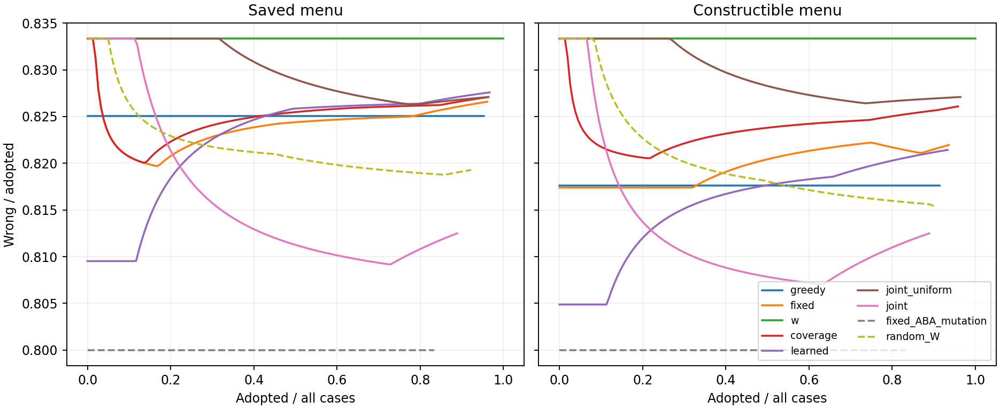

# 请求历史能否迁移到未见接口故障？

2026 年 11 月 24 日 · 日历开发集 → 有状态库存查询接口

**研究决定：历史关系有跨工具测试价值；本轮学习式选问未通过作为通用算法的验收。** 联合策略在两种权限中都发现 40 个反例，优于贪心和轮换五模板。但把开发集上最有价值的 A→B→A 固定下来，再用同一变异分数选择具体请求，两种权限都能发现 60 个。联合策略的多数命中集中在切仓后重查同一商品。研究上最值得保留的是能量化这种集中程度的评测体系。

## 开发、冻结与迁移

在上一轮的 48 个日历布局中重新采集平衡的关系探测轨迹。每个布局使用五种身份模板、两种编码设置、一个正常服务与五个旧故障服务，共 2,880 个会话、8,166 次本地调用。别名包装交给同一个日历查询，开发时允许区分字节和语义。用实际输出第一次偏离预测的位置给前缀打标。未导入 Oracle 的选问结果。保存了开发计数、关系权重与选择器源文件的 SHA-256。

自动关联的范围是预定义关系语言。对每一段两问或三问的前缀，分别按请求字节、规范化操作及参数、操作名称进行相等关系编码。例如同一商品的两种编码在字节通道属于 AB，在语义通道属于 AA。算法从交互中估计各关系的反证价值。日历开发集里，按原始请求编码，第三问时 ABA 有 73/242 次偏离，ABC 有 121/943，ABB 为 0/227。这是上一步仍未推翻解释的条件命中率。

对每种关系 f，以 (命中数+1)/(观测数+2) 估计命中率，并除以同深度的开发平均值。未见的关系回退到同深度平均。关系分为各通道、各前缀权重乘以 1/√(1+已安排次数) 后的平均。每种策略自行累计此前布局的计划曝光次数；这个计数不读取正式服务的故障标签、测试结果或 Oracle。联合组以等权相加的方式使用候选序列内归一化后的关系分和已知变异体命中比例，λ 固定为 1。仅关系覆盖使用均匀权重，另设仅学习权重及联合但去掉学习权重两组。该实现穷举合法三问列出其公开分数。

正式测试使用独立实现的、可重置的库存会话黑盒。每个库存布局有两个仓库和四个商品；切换仓库改变之后查询的合法预期数量。已有菜单为 4 或 5 个请求，可构造菜单含 10 个合法请求（包括不同编码）。两种权限都有切换当前会话仓库的能力；未改变实际库存。每个场景从仓库 0 开始，最多三问，第一次不一致即停。一次初态重置独立计数，过程中不能重置；每方法、每权限均 360 次重置。60 个布局分别有 1 个正常及 5 个带故障服务。两种权限复用相同布局配对，首次请求也由各策略选择。未调模型权重、提示或学习超参数。

正式故障包括同一商品换编码重查时少一件、切换仓库后重查原商品时读到旧仓、连续选择同仓后读取库存为零、不同同货架商品串用游标，以及切换仓库后延迟提交（需四问）。这些实现未进入开发或选问器。关系类别可以与旧日历共享，这是迁移实验设计的一部分。基准为本地受控实现，库存在该布局内固定且两仓数量不同。

## 方法及结果

每权限 300 个错误解释和 60 个正确解释。下表的分母是相应权限下三问可达的错误解释数；风险为 180/360 个场景被采用时的条件错误比例。按共同的已知变异体覆盖比例从高到低选择未被推翻的解释，同分组按比例随机采用。此门槛不要求原日历的 1,106 条规则证书；库存基准采用库存变异体评分。不同工具之间不能直接相减准确率。

| 策略 | 已有菜单命中 /177 | 可构造命中 /240 | 已有菜单风险 | 可构造风险 |
|---|---:|---:|---:|---:|
| 逐问贪心变异 | 17 | 31 | 82.51% | 81.76% |
| 五种字节身份模板等次轮换 | 14 | 23 | 82.44% | 82.04% |
| W 法，优先不同状态转移、再按变异得分 | 0 | 0 | 83.33% | 83.33% |
| 均匀关系覆盖 | 13 | 15 | 82.55% | 82.38% |
| 仅学习关系权重 | 12 | 24 | 82.59% | 81.77% |
| 变异 + 均匀关系 | 13 | 13 | 82.90% | 82.83% |
| **变异 + 学习的关系权重** | **40** | **40** | **81.13%** | **80.78%** |
| 补充对照：W 三问序列内均匀抽取 | 28 | 35 | 82.05% | 81.81% |
| 补充对照：固定 ABA，再按变异得分 | **60** | **60** | **80.00%** | **80.00%** |

主实验先完成 5,040 个库存会话。看到命中集中于切仓后重查，另作上述两个补充对照，共 1,440 个会话，已有权重与结果均冻结。固定 ABA 在开发集已有依据，但将它作为单独的强对照是看过正式结果后的诊断选择。相对贪心，联合组的可达命中率差为 +12.99 和 +3.75 个百分点，按布局配对重采样 10,000 次的 95% 区间依次为 [+8.79,+17.51]、[0.00,+7.92] 个百分点。相同覆盖率下，风险降低 1.38、0.98 个百分点，相应差值区间为 [−1.93,−0.83]、[−1.62,−0.28]。联合相对固定 ABA 的可达命中率则低 11.30 和 8.33 个百分点，区间为 [−15.79,−7.26]、[−11.25,−5.42]。这些区间是在给定布局顺序和已冻结调度记录上的条件估计；没有对全新开发集、故障族与调度顺序的波动进行估计。故障占比为 5/6，绝对风险由这一挑战集配比决定。

## 强基线的适用范围

库存参考模型为最小二状态 Mealy 机。最小状态覆盖为 {空序列，选择仓库 1}，任一商品查询即可区分两仓。实现 W 测试套件 S·Σ^{≤2}·W，以一个额外潜在状态的深度生成套件，从中选一条长度恰好为 3 的序列与其他方法对齐。每布局用固定种子选取区分输入。完整套件含更长的序列，也要求多次重置。本轮的 W 结果只代表三问单会话下的套件选取，无法推及完整 W 法。优先覆盖不同转移的选取连续 60 次选择 ABC，零命中；改成均匀抽取后结果为 28 和 35。这说明三问预算下，套件内部怎样选一条序列对结论有实质影响。[TACAS 2024 的套件构造](https://link.springer.com/chapter/10.1007/978-3-031-57249-4_6) · [MODELS 2023 的八种一致性测试比较](https://ieeexplore.ieee.org/document/10344169/)

## 反例归因

布局 0：stock?id=2 返回 83，select?id=1 确认切换仓库，再次 stock?id=2 按新仓应返回 35，实际仍返回 83。三条轨迹已经足以推翻该会话的库存解释，也能排除“原本两仓库存相等”的替代解释。

| 故障 | 已有菜单可达 | 联合命中 | 可构造可达 | 联合命中 |
|---|---:|---:|---:|---:|
| 换编码导致库存少一件 | 40 | 0 | 60 | 0 |
| 切仓后读到旧仓 | 60 | 35 | 60 | 33 |
| 连续选同仓后返回零 | 60 | 0 | 60 | 2 |
| 同货架不同商品串用游标 | 17 | 5 | 60 | 5 |
| 延迟提交（需第四问） | 0 | 0 | 0 | 0 |

固定 ABA + 变异在两种权限都找出全部 60 个旧仓故障，其他故障命中为零。联合策略分散了部分测试机会，额外找到 5 或 7 个其他故障，但失去了 25 或 27 个旧仓见证。尤其值得注意，联合组在可构造菜单拥有全部商品别名却没有发现任何别名故障；均匀抽取 W 序列反而发现了 11 个。这是反证能力随关系权重而改变的实证例子。

## 预算、权限与计算

对每个合法三问序列重置黑盒并回放所有故障。对于未找到反例的机制，再在同权限内查找四问见证。已有菜单将 300 个故障拆成三问可达 177、第四问才可达 60、缺少必要输入 63；最后一项分别缺少别名 20 和同货架第二商品 43。可构造菜单的划分为 240、60、0。这里超出预算的 60 个延迟提交故障均有实际第四问见证。权限不足的归因还利用隐藏实现对必要输入的要求，应用到未知线上接口时，仅靠有限查询无法证明永远不可达。

联合方法在已有、可构造菜单各用 1,078 和 1,077 次真实本地接口调用，贪心各用 1,073 和 1,061 次，固定 ABA 对照各用 1,080 次。各组预算上限与重置数相同，实际调用数随提前发现反例而变化。完整三问诊断在五个错误服务上依次消耗 93,544、885,600 次调用和 31,400、300,000 次重置。开发调用、四问诊断、主测试和补充对照独立记账。

当前实现仍在 CPU 上枚举所有三问序列并缓存公共预测，总计 6,280 与 60,000 个候选序列。对预计算后的候选打分，联合组平均每布局耗时 0.21 和 2.50 毫秒。含共享预计算与全部七组选择的 CPU 时间合计约 0.11、1.55 秒；五个故障的三问穷举回放约 0.11、0.50 秒。两者工作范围不同，目前的证据支持减少真实调用，未建立本地搜索的 CPU 优势。重置是在内存中创建新会话，实际部署环境的重置延迟与价格尚未测量。

## 研究取舍

本轮确实把日历中的信号迁移到了库存服务上的新故障实现。不过，优势主要由同一个请求关系解释，联合策略未超过固定 ABA + 变异的低成本基线，同时在另一种别名关系上整族漏检。按事先提出的门槛，停止沿此启发式增加权重、模板和模型复杂度。已有材料足以组织一项实证研究，重点是不同选问策略在哪些状态依赖上失效、哪些遗漏源于权限或预算，以及只比较平均命中率会如何掩盖这些差异。日后若要恢复方法研究，宜以新的独立工具验证能否预测“当前该优先哪种关系”，并保留开发集最佳单模板作为正式基线。

[开发权重与轨迹计数](../runs_history_relation_20261124/development.json) · [主实验汇总](../runs_history_relation_20261124/summary.json) · [补充对照](../runs_history_relation_20261124/control_summary.json) · [逐场景执行记录](../runs_history_relation_20261124/decisions.json) · [对照执行记录](../runs_history_relation_20261124/control_traces.json) · [可达见证和重置成本](../runs_history_relation_20261124/frontier.json) · [具体选问与成本](../runs_history_relation_20261124/plans.json) · [冻结选问算法](history_relation_policy.py) · [库存服务与回放](history_relation_inventory.py)
