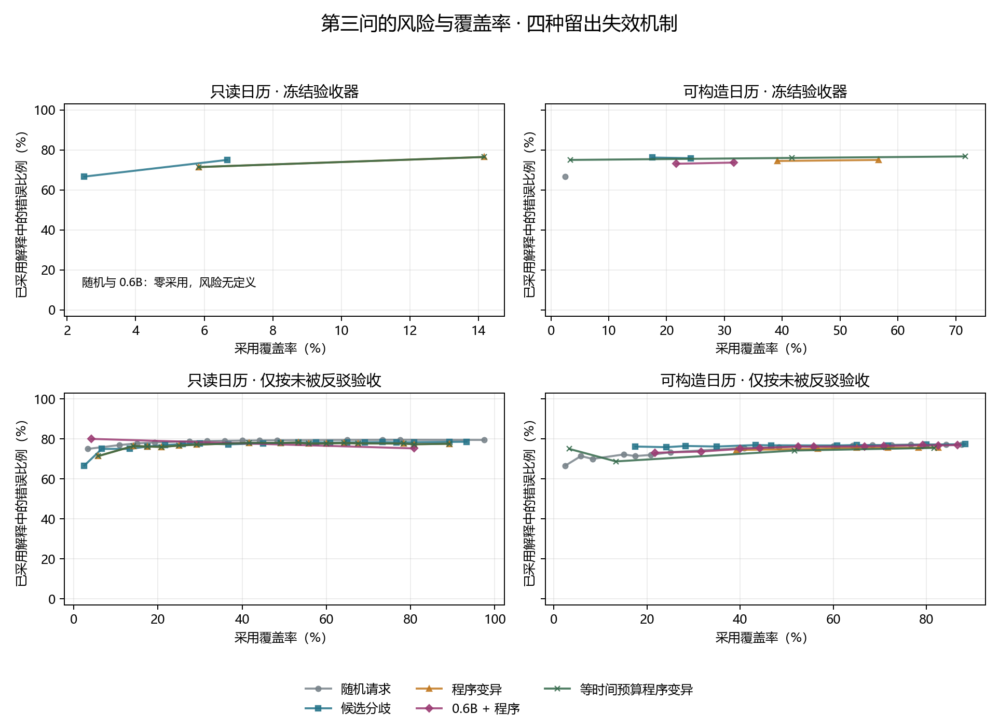

# 第三次工具调用能否推翻错误的接口解释？

2026 年 11 月 23 日 · TinyAgent 黑盒日历一致性实验

**研究决定：停止在这套日历基准上继续调整 0.6B 的提示，将主线转向权限约束下的可辨识性和低成本一致性测试。** 在可构造日历的 96 个留出故障上，模型与程序共推翻 16 个错误解释，常规程序变异推翻 21 个，等时间预算程序变异推翻 22 个。在只读日历上模型推翻 23 个，全部来自重复请求触发的状态异常；简单的重发操作命中 24 个，而且调整菜单编号后模型的重复请求偏好明显改变。冻结验收器未显示模型在正覆盖率下有稳定的风险优势。

## 实验依据

Balestra 等人在 ICST 2026 用语言模型生成可执行测试，挑战 SpecFuzzer 从有限轨迹推断出的 Java 断言。其报告中的 GPT-5.1 过滤了 1,877 条无效规格，推断精度提高约 7%，召回保持不变。这项工作已经覆盖“用模型生成反例，然后通过执行核验”这一思路。本轮测的是不同条件：黑盒接口、冻结的 0.6B、至多三次调用、受限测试权限，以及错误解释被采用的风险。程序变异对照借鉴以区分变异体为目标的黑盒一致性测试；这里没有复现自动机论文的完整学习算法。[ICST 论文全文](https://arxiv.org/html/2604.10761) · [IEEE 出版记录](https://doi.org/10.1109/ICST69053.2026.00059) · [Aichernig 与 Tappler 的变异测试研究](https://link.springer.com/article/10.1007/s10817-018-9486-0)

## 上轮 32 个暂缓场景

复用原始决策、1,106 种程序、每个布局的公开探测菜单和留出日程。固定原有首问，穷举后续两个合法请求。对每个真实服务，枚举所有能解释首问、且至少在一个留出日程上产生错误答案的竞争者。能排除所有这些竞争者，才算该服务在这个行为口径下可区分。存在一条成功路径只说明事后可构造见证；在线策略看不到真值，仍需自己选到它。

| 暂缓的原因 | 场景数 | 可复查的解释 |
|---|---:|---|
| 保留原第二问，仅换第三问即可区分 | 22 | 如 0-compound-2，原第二问为 2，第三问由 4 改成 9 即可 |
| 原第二问已用掉机会，改选第二、三问可区分 | 8 | 如 2-compound-0，原组合为 8、9，改成 5、6 可区分 |
| 所有允许请求都查遍仍有竞争解释 | 2 | 至少一个竞争规则在全部合法输入上返回相同，但在留出日程上给出不同答案 |
| 查遍能区分，但首问固定且总预算为三次时没有可行路径 | 0 | 与上面的权限不足独立判定 |

原验证器还使用一个更窄的标准：若剩余程序在公开菜单上行为等价，可以采用。该标准下，有 31/32 个场景存在可解除暂缓的请求对；它可以合并两个本来会在公开菜单之外表现不同的解释。报告上表关注的是带有具体留出反例的竞争解释。[逐例枚举和请求编号](../runs_third_probe_20261123/prior_32.json)

## 新实验的控制变量

每个布局固定一个已经提出的契约 H，分别轮换按 ID 去重、排除状态 1、按优先级降序打破时间并列，最后均取三条。这里研究指定 H 的核验阶段。1,106 条规则来自上轮原库，所有策略使用相同的候选过滤和等价性验收逻辑。前两次查询及其返回对同一布局的全部服务逐项相同。冻结模型为 P11 seed 08 的 Qwen3-0.6B，无权重更新，每个可见历史和权限仅做一次主实验生成。

开发机制是规模依赖、时间并列和操作顺序。最终评估保留四种此前没有用来选择探测算法或训练权重的黑盒失效机制：状态为 2 时才按所有者去重；请求跨月时遗漏末条；请求窗口含闰日时遗漏首条；连续重发同一视图时返回空结果。跨月与闰日是两个相关的日期边界变体。稳定服务与四种失效服务在 24 个布局中逐一配对，每种权限共 120 个最终场景，含 24 个稳定、96 个错误解释。开发场景另有 72 个/权限，不计入主结果。最终机制对生成器隐藏；模型在本轮没有用于学习跨机制迁移的训练集。

**只读权限**只允许访问 12 个固定日历视图，含重发前两次查询；这是有限白名单，任意新窗口不在权限内。**可构造权限**额外提供 18 个由程序预构造的布局，并允许生成器提交新日历参数（日期、窗口跨度、事件数、时间槽数和所有者槽数）。日期在此是请求窗口元数据；该环境不模拟生产日历的时区、鉴权或远程服务。状态依赖通过向黑盒传入相同的两次请求历史来执行，每种方法单独恢复历史。所有方法的调用上限相同。

| 方法 | 选择第三问的算法 |
|---|---|
| Random Probe | 在合法公共菜单上按布局种子均匀抽一个请求 |
| Program Disagreement | 按预测返回对仍存活的全部候选分组，选分组大小平方和最小的请求 |
| Program Mutation | 对 H 做一步插入、删除、交换或替换，优先取仍能解释前两问的库内邻居，选能推翻最多邻居的请求；并列时用全库分歧破同分 |
| TinyAgent + Program | 模型看到 H、前两份完整轨迹、允许请求及事件行，提出一个测试和理由。程序核对权限、构造并执行；无法从输出读出合法请求时回退到 Program Mutation |
| 同时间预算的程序变异 | 只读时已搜完整个白名单；可构造时，用大致等于模型生成的摊销墙钟时间搜索更多合法布局，最大化同一变异目标。计时按每次实际运行，截止点可能多用一个候选的时间 |

同一验证器在第三问产生反例时否决 H；若 H 通过，还要求存活候选在同一份公开参考菜单上均与 H 等价。这个验收标准沿用上轮，专门核验已提名的 H。公开参考菜单在不同方法间保持一致。对通过者进一步按第三问排除的候选比例排序，报告覆盖率（采用/全部）、选择性风险（错误/采用）及正确采用覆盖率（正确采用/全部）。相同分数作为一个整体，匹配目标覆盖时只在边界同分组内随机化插值。若没有可比较的正覆盖，风险无定义。另报告仅以“未被反驳”为条件的诊断曲线，以观察测试本身的效果。

## 第三问究竟推翻了什么

每列分母 24，总计分母 96。每个方法在每种权限的最终面板执行 120 组独立的三调用流程，共 360 次本地黑盒调用，含稳定对照。两种权限分别报告。

| 权限 | 方法 | 条件去重 | 跨月 | 闰日 | 依赖前次请求 | 合计 |
|---|---|---:|---:|---:|---:|---:|
| 只读 | 随机 | 0 | 2 | 0 | 1 | 3 |
| 只读 | 候选分歧 | 2 | 3 | 3 | 0 | 8 |
| 只读 | 程序变异（含等时间预算组） | 3 | 5 | 5 | 0 | 13 |
| 只读 | 0.6B + 程序 | 0 | 0 | 0 | 23 | 23 |
| 可构造 | 随机 | 0 | 9 | 5 | 1 | 15 |
| 可构造 | 候选分歧 | 3 | 8 | 3 | 0 | 14 |
| 可构造 | 程序变异 | 3 | 12 | 6 | 0 | 21 |
| 可构造 | 0.6B + 程序 | 2 | 9 | 5 | 0 | 16 |
| 可构造 | 等时间预算程序变异 | 6 | 15 | 1 | 0 | 22 |

只读时，相对程序变异，模型多捕获 23 个历史依赖故障，错过全部 13 个程序变异能捕获的其他故障，净差 +10/96。按 24 个布局配对重采样，反驳率差为 +10.42 个百分点（95% 区间 +3.13 至 +17.71）。可构造时，相对普通变异多捕获 1 个、漏掉 6 个，差 −5.21 个百分点（−12.50 至 +1.04）；相对等时间变异多捕获 8 个、漏掉 14 个，差 −6.25 个百分点（−15.63 至 +3.13）。这些区间针对同四种机制内的布局差异。

**操作归因。** 只读时 24 个模型请求全部可解析，23 个重发第二问。因为规则预测仍会返回原来那一页，实际返回空列表就构成直接反证。事后增加的“总是重发末次请求”对照只用了同样的一次额外调用，命中全部 24 个状态依赖故障，其余三类均为零。模型在若干理由中谈的是两份日历窗口不同，这些文字不足以表明它推断出了缓存或状态机制。可构造时，14/24 个提案可执行，全部选择了菜单中的第 15 号预制请求；另外 10 个回退到程序变异。16 次反驳中只有 6 次来自合法的模型选择。模型自行构造的新日历为 0。

**菜单编号复核。** 在看到集中选项后，取布局编号 0、3、6、9、12、15、18、21，重排选项、重写第一问与第二问的索引提示，保持真实请求、模型和反例不变。只读组原先 8/8 次重发第二问，重排后只剩 1/8 次；两次都能解析的 7 对中，只有 1 对指向同一物理请求。可构造组两次都能解析的 4 对，没有一对指向同一物理请求。这项事后诊断表明输出依赖呈现方式，不能单凭原菜单中的 23 次命中认定模型发现了新维度。

## 风险与覆盖率

上排使用冻结验收器，下排单独显示“未被反驳即可能采用”的诊断。横轴是总采用覆盖率，纵轴为已采用解释中错误的比例。阈值点间连线供阅读；匹配正确采用数的数值另按同分组计算。样本按设计含 80% 错误解释，因此图上的绝对风险依赖本面板的混合比例。

| 权限 | 默认阈值下的策略 | 正确采用 | 错误采用 | 总覆盖率 | 已采用中的错误比例 |
|---|---|---:|---:|---:|---:|
| 只读 | 随机 | 0 | 0 | 0% | 无定义 |
| 只读 | 候选分歧 | 2 | 6 | 6.67% | 75.00% |
| 只读 | 程序变异 | 4 | 13 | 14.17% | 76.47% |
| 只读 | 0.6B + 程序 | 0 | 0 | 0% | 无定义 |
| 可构造 | 随机 | 1 | 2 | 2.50% | 66.67% |
| 可构造 | 候选分歧 | 7 | 22 | 24.17% | 75.86% |
| 可构造 | 程序变异 | 17 | 51 | 56.67% | 75.00% |
| 可构造 | 0.6B + 程序 | 10 | 28 | 31.67% | 73.68% |
| 可构造 | 等时间预算程序变异 | 20 | 66 | 71.67% | 76.74% |

在可构造条件下，将正确采用数匹配到 **10/120（8.33%）**，模型组的风险为 **73.68%**，普通程序变异为 **74.47%**，等时间变异为 **75.98%**。模型相对等时间变异差 **−2.30 个百分点**。按布局重采样 10,000 次，每次在两组均可达的最大正确采用数上重新匹配，差值区间为 **−6.32 至 +0.95** 个百分点；相对普通变异的相应区间为 **−4.95 至 +2.68**。两个区间都跨零。只读模型组在冻结门槛下没有正的正确采用覆盖率，不能把“未发生错误采用”解释为优于程序。只按未被反驳验收时，两种方法都能保留 24 个稳定场景，可构造权限下模型错误风险为 76.92%，普通程序变异为 75.76%。

**计算开销。** 主面板共 48 次冻结模型生成：只读 47,624 个提示文本 token、1,561 个输出 token；可构造 114,599 个提示文本 token、1,936 个输出 token。输入 token 按公共提示文本统计，不含聊天模板开销。每种权限各约 102.92 秒摊销生成时间。普通变异的 24 个布局第三问选择累计约 0.087 秒（只读）、0.168 秒（可构造）。等时间程序在可构造权限下累计约 102.99 秒、另探索 516,778 个候选输入，仍只执行最终选中的那次工具调用。墙钟预算包括生成方法特有的选择步骤，候选库初始化、共有的校准和评分、模型加载与菜单重排诊断另外计。GPU 与 CPU 的电耗或货币成本未作等价假设。

## 权限本身留下了多少可能性

只读菜单能揭露条件去重、跨月、闰日、历史依赖的布局分别为 **5、23、11、24** 个，合计 **63/96**。其余 33 个，即使事后知道应查什么，合法第三问里也没有反例。可构造权限的预制菜单能揭露 **84/96** 个；离线额外构造实际见证后，**96/96** 个都有合法反例。这个上限是逐场景存在性结论，每个可见前缀对应多个隐藏行为，在线算法无法预知哪一种正在运行。

本轮最能指导后续工作的是两种不同的错过。第一种是权限不足，如某些只读布局在所有允许窗口上都没有能暴露条件去重的记录组合。第二种是测试生成目标遗漏了系统状态：行级程序变异倾向于查内容不同的新日历，同一请求连续执行这项便宜的测试没有得到分数。把“请求序列”纳入测试模型，应优先于重复增加日历字段提示。后续可用新的、有副作用隔离的读接口采集留出服务，预先固定状态变异与窗口变异，按调用预算核算反驳能力、采用覆盖和选择性风险。当前已达到停止继续调整 0.6B 提示的阶段门槛。

## 复核材料

- [主要结果与区间](../runs_third_probe_20261123/summary.json) · [匹配风险与顺序复核](../runs_third_probe_20261123/supplement.json) · [风险曲线数据](../runs_third_probe_20261123/risk_coverage.json)
- [模型原始输出](../runs_third_probe_20261123/model.json) · [实际第三问与代价](../runs_third_probe_20261123/plans.json) · [逐服务实际执行](../runs_third_probe_20261123/decisions.json) · [合法反例可达性](../runs_third_probe_20261123/reachability.json)
- [冻结规则下的选择与核验](third_probe_compare.py) · [服务机制与权限定义](third_probe_inputs.py) · [32 例的可辨识性复核](third_probe_identifiability.py)
