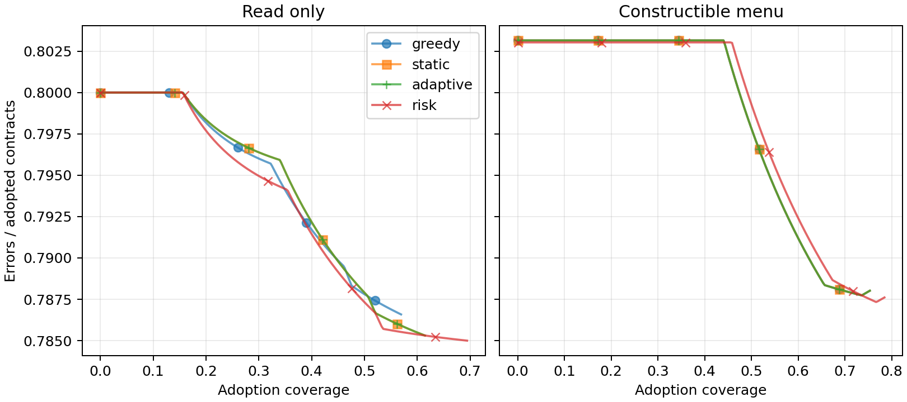

# 两步主动反证实验报告

2026 年 11 月 23 日

**普通两步规划未提高可达反例命中率。** 只读日历中，贪心与两步策略都命中 60/211，可构造菜单中都命中 62/240。风险感知规划在只读条件下增加了 4 个反例，但在相同采用覆盖率下，两种权限均未显示稳定的降险效果。本轮支持把“能否观测行为差异”和“测试策略是否会选择见证请求”作为主问题。仅凭这组结果，尚无依据把两步自适应作为独立的方法贡献。

## 设计与比较边界

复用已有日历生成器、三种轮换的待检验解释、1,106 条公开规则，以及“与观测一致的规则在整个参考菜单上等价”的验收条件。正式集使用此前未参与这些实验的 48 个布局编号 1200–1247，各含 1 个正常服务和 5 个新实现的故障服务。相同布局跨方法和权限配对。每种权限有 288 个场景，其中 240 个解释确实错误。所有方法都先执行相同首次请求，剩余两问最多执行两次，发现反例立即停止。模型调用和参数更新均为零。

五种故障分别是不同视图日期重叠时沿用上次结果、隔一次调用重新打开原视图时返回空、向更早日期查询时漏掉首条、分页切口两侧所有者相同时多返回一条、跨季度时漏掉末条。故障是本轮新实现，日期边界和缓存的大类与过去研究有关。规划器无法读取后端机制、隐藏标签或诊断用枚举结果。

只读权限有 12 个现成视图，可构造权限另有 18 个预生成测试日历。两者分别允许 144 和 900 个有序请求对，可以重发同一请求。可达性结论严格限于指定首次调用、该菜单和剩余两次调用。单个场景的 Oracle 可以利用隐藏实现寻找见证，仅用于划定可达上限。历史 32 例只进诊断集。

## 核心算法

用第一条真实返回筛选与之相容的公开规则。提取与当前解释相差一次编辑、且在菜单上行为不同的变异体，并加入上轮已知的“连续重发返回空”变异体。多步预测保留请求历史。普通方法对进入池中的变异体等权，编辑距离、语法重复与生成器的偏好都会影响其代表性。

令 `K(a | D)` 为在历史 D 后发出请求 a 时，预测与当前解释 H 不同的变异体集合。剩余者中，若第三问 b 的预测首次出现差异，即可继续反证。每个候选请求对的得分为

    |K(a | D) ∪ K(b | D, a, H(D,a))|

- **贪心变异**先最大化第二问击中的变异体数。第二问通过后，根据剩余变异体重新选第三问。
- **静态两步**预先遍历有序请求对，最大化并集大小。发现反例时提前停止。
- **自适应两步**为每个第二问求通过分支上的最佳第三问，选择总反证质量最大的第二问。真实返回到达后重新选择第三问。各法共享请求顺序和公开分歧的破平规则。
- **自适应两步 + 风险**使用同一批变异体。正常与异常的设计先验各占一半，错误采用代价为 4、暂缓正常解释为 1、每次调用为 0.01。将剩余异常质量、第三问的预期成本和终点能否满足验收条件写入请求对的损失。通过验收且采用的预期损失不高于暂缓才采用。这些代价和先验是实验设定，无真实服务校准。

**为什么静态和自适应可以完全相同？** 对一个给定历史的确定性 H，第二问只有一种输出仍与 H 相容。任何其他输出都已推翻 H，任务结束。因而一个自适应策略至多有一条需要执行第三问的分支，沿这条分支的最佳请求可以预先写下。该论证允许 H 依赖历史，也允许第三问重复前面的请求。不能由此推到多规则识别、带噪服务、允许多个合法输出的规格，或推翻后还要继续定位错误的任务。两步前瞻仍可能胜过贪心；本轮专门检验了这一点。

## 正式结果

| 方法 | 只读命中 / 可达 | 只读正确采用 / 错误采用 | 可构造命中 / 可达 | 可构造正确采用 / 错误采用 |
|---|---:|---:|---:|---:|
| 贪心变异 | 60/211 | 35 / 129 | 62/240 | 46 / 171 |
| 静态两步 | 60/211 | 38 / 139 | 62/240 | 46 / 171 |
| 自适应两步 | 60/211 | 38 / 139 | 62/240 | 46 / 171 |
| 自适应两步 + 风险 | 64/211 | 43 / 157 | 62/240 | 48 / 178 |
| 知道真实行为的 Oracle | 211/211 | — | 240/240 | — |

普通两步与贪心的命中差在只读权限下为 0 个百分点，48 个布局配对重采样的 95% 区间为 −1.43 至 +1.41 个百分点。两步新找到 3 例，同时漏掉贪心找到的 3 例。可构造权限下，两者逐场景请求完全一致。风险组比贪心在只读权限下多找到 4 例，即 +1.90 个百分点，95% 区间为 −0.48 至 +4.69。可构造权限下总数相同。

| 采用覆盖率固定在 50%（144/288） | 贪心 | 静态 / 自适应两步 | 自适应两步 + 风险 |
|---|---:|---:|---:|
| 只读，已采用中的错误比例 | 78.78% | 78.79% | 78.73% |
| 可构造，已采用中的错误比例 | 79.78% | 79.78% | 79.93% |

覆盖率以全部采用数除以全部场景数计算。同一风险分的边界组按相同比例随机采用，表中给出预期错误比例。仅在满足各组验收条件的记录中扫阈值。风险组相对贪心的错误比例差，只读为 −0.05 个百分点，区间 −0.49 至 +0.30；可构造为 +0.15 个百分点，区间 −0.03 至 +0.48。10,000 次布局重采样中，只读有 9,121 次双方都能达到 50% 覆盖率，区间只使用这些重采样；可构造为 10,000 次。测试中 5/6 的接口有错，这些比例描述受控挑战集。高风险的直接原因是验收器只检查已知规则，而新的故障服务常与 H 给出完全相同的观测。

## 一个可达但全部在线方法错过的反例

布局 1200 的第一问查询视图 0，得到 372、835、808。只读条件下，贪心与普通两步继续查视图 7、5，三次返回都符合 H。实际服务在“打开 A，打开 B，再打开 A”时会丢掉结果。用相同预算依次查 0、1、0，最后一步预期仍为 372、835、808，实际返回空列表。三步里没有任何相邻的重复请求，因此已知“连续重发”变异体给这个测试的激励不足。两种权限下，每种在线策略在这一机制上均为 0/48，同样的 48 个布局全部存在合法反例。

只读的 240 个错误解释中，29 个在指定预算和菜单下没有见证，其中 27 个为跨季度故障，2 个为分页切口故障。另有 151 个可达案例被普通两步漏掉。可构造菜单中全数可达，普通两步仍漏掉 178 个。增加候选测试让更多反例成为可能，却未使既有变异体的得分函数自动选中它们。

## 历史 32 例

旧任务要求从多个规则中识别真实行为，事先没有指定唯一 H。为保留原问题，单独使用历史许可菜单和首次真实返回，在线选择第二、第三问。贪心优先本步能使剩余规则在公开菜单上达成一致的候选质量；静态与自适应最大化两步后的这一质量，平局时减少剩余分支碰撞。到最终评分时，检查所有剩余规则是否与服务在原先的 43 个独立检查日历上逐一一致。检查日历和真实规则均不参与选问。

| 历史诊断类别 | 场景数 | 贪心通过 | 静态通过 | 自适应通过 |
|---|---:|---:|---:|---:|
| 只换第三问就有见证 | 22 | 9 | 13 | 11 |
| 必须提前换第二问 | 8 | 2 | 2 | 2 |
| 当前菜单有无法区分的竞争解释 | 2 | 0 | 0 | 0 |

必须调整第二问的三组都解决同样的两个布局案例：2-compound-0、14-compound-0。历史分析给出的 8 个见证是逐场景的存在性结论，提前不知道真实规则的选问器仅找到其中 2 个。该验收项未出现净改善。

## 调用、计算及研究决定

每种在线方法在 288 个只读场景共执行 833 次本地接口调用，在 288 个可构造场景共执行 819 次，均包含共同首次调用。若全部用满预算，每组每种权限为 864 次。可达性诊断额外执行 16,320 和 53,625 次后端预测/查询，不进入在线方法的预算。

48 个布局共用的规则预测预计算分别执行 397,920 和 915,168 次解释器计算，占 CPU 时间约 1.28 秒和 3.42 秒。预计算之后，每布局的初始规划平均墙钟耗时：只读贪心 0.0105 毫秒、静态 0.0653、自适应 0.0417、风险 0.1065；可构造分别为 0.0136、0.3804、0.1895、0.6084 毫秒。在线第三问重选另计，可构造自适应平均每场景 0.0051 毫秒。亚毫秒时间以本机墙钟计，进程 CPU 时钟只适合报告汇总量。全部在线和 Oracle 的实际执行轨迹共 2,880 条。

此前的变异测试工作已将找反例的代价列为主动学习瓶颈；AALpy 支持用输入输出序列对响应式系统进行一致性测试。本轮实现的是面向有限日历菜单的贪心与两步变异基线，两篇论文的完整系统均未参与跑分。[变异驱动的一致性测试](https://link.springer.com/article/10.1007/s10817-018-9486-0) · [AALpy](https://link.springer.com/article/10.1007/s11334-022-00449-3)

建议把下一项方法验证设为**有限预算下的请求历史覆盖**。可在相同公开请求上比较已有变异得分、固定序列覆盖（重发、返回旧视图、交换请求顺序）及两者的组合；把本轮发现的“隔一次重开”放进开发集，以另一种工具上未用于设计的状态机制评估迁移。继续分别报告可达命中率、同覆盖率风险和真实调用数。若只能找回已知重开故障，适合把结果写成特定机制的回归测试；若对未见机制也有收益，再讨论作为通用方法的增量贡献。

[规划器与黑盒服务](two_step_falsification.py) · [历史在线诊断](two_step_historical.py) · [统计与绘图](two_step_results.py) · [结果汇总](../runs_two_step_20261123/summary.json) · [原始调用轨迹](../runs_two_step_20261123/traces.json) · [合法见证](../runs_two_step_20261123/reachability.json) · [历史逐例结果](../runs_two_step_20261123/historical.json) · [规划成本](../runs_two_step_20261123/costs.json)
